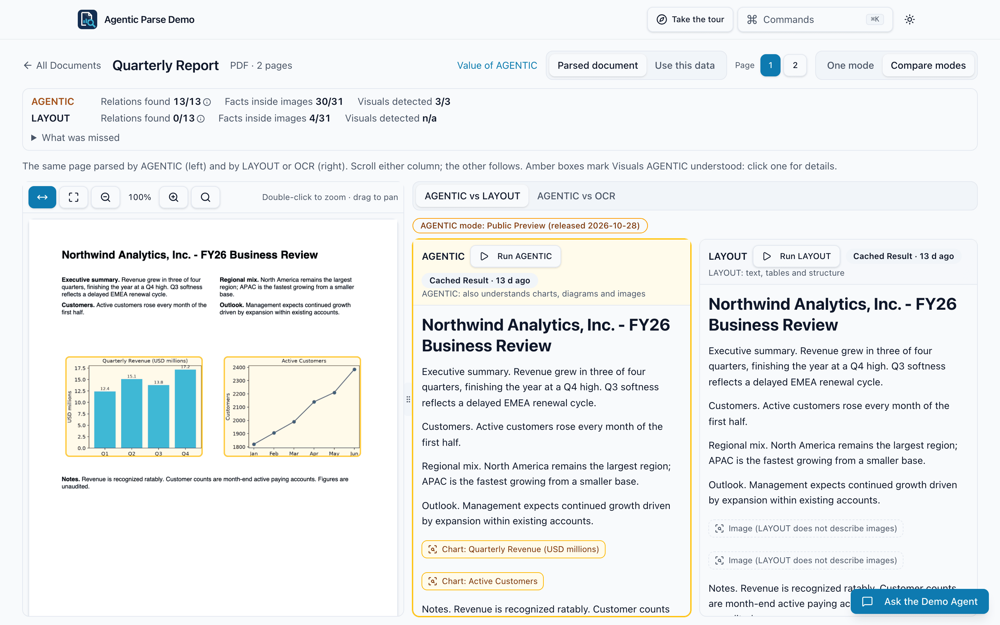
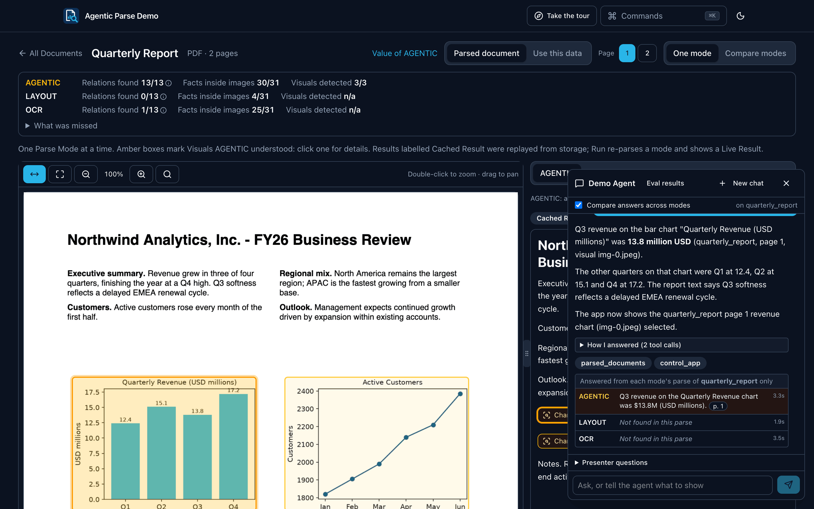
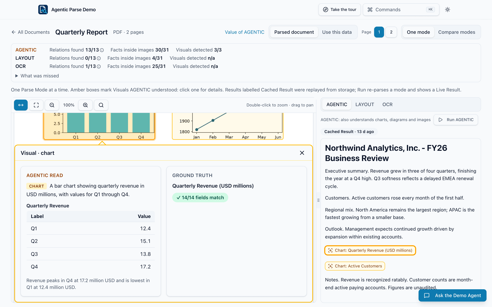
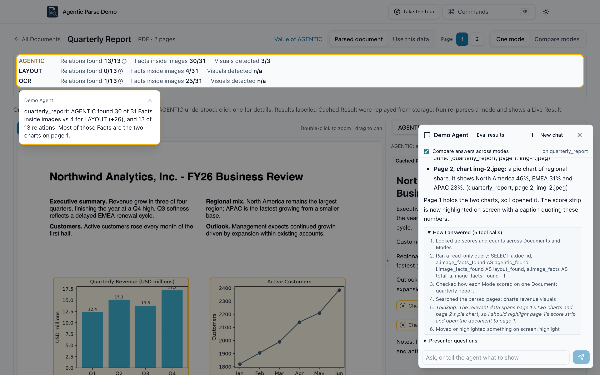
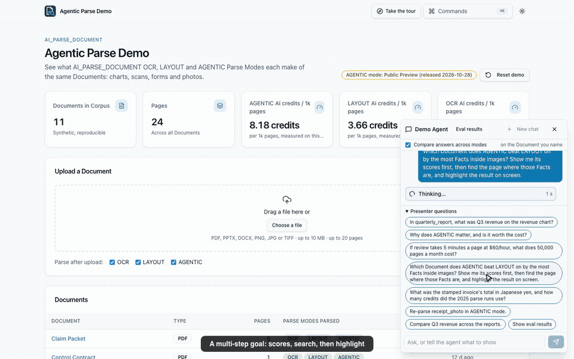
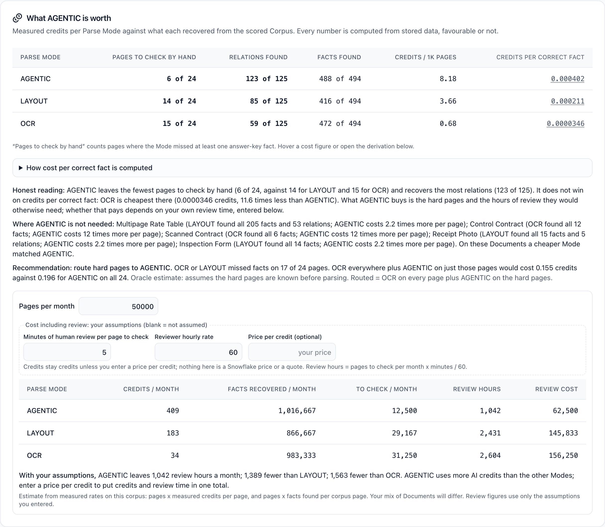
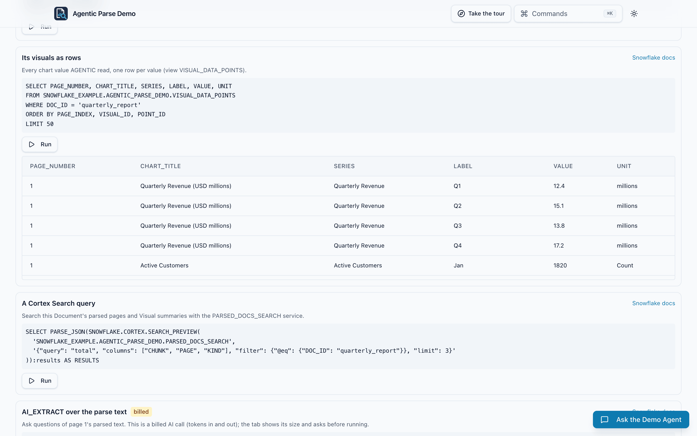
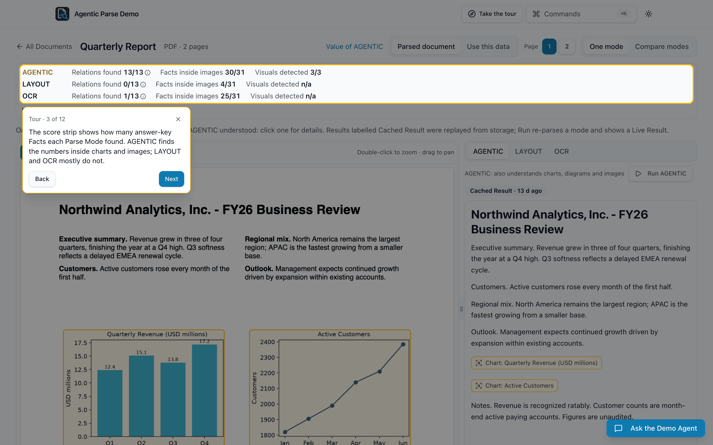
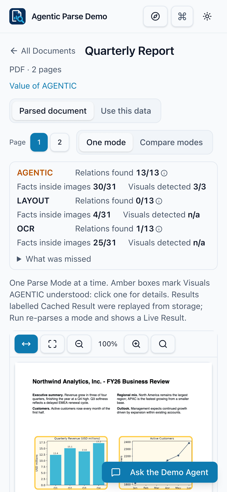
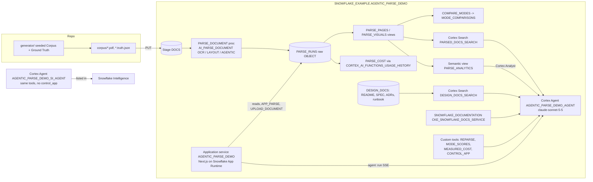

# Agentic Parse Demo

A reusable demo of [AI_PARSE_DOCUMENT](https://docs.snowflake.com/en/sql-reference/functions/ai_parse_document) **AGENTIC** mode next to **LAYOUT** and **OCR**: one synthetic set of visual Documents, parsed in all three Parse Modes, scored against Ground Truth, and shown in a web app with a Cortex Agent that answers with citations and drives the screen.



## Why it matters

- **The problem.** A lot of what matters in business documents sits in charts, diagrams, stamps, forms and photos. Text extraction reads the words around them and skips the facts inside them, so a person still opens the page and checks it by hand. That review is usually the real cost.
- **What AGENTIC changes.** [AGENTIC mode](https://docs.snowflake.com/en/user-guide/snowflake-cortex/parse-document#agentic-mode) (Public Preview, [released 2026-10-28](https://docs.snowflake.com/en/release-notes/2026/other/2026-10-28-ai-parse-document-agentic-mode-preview)) finds each Visual and returns what it means, for example a chart's series as a table, a value with its label, an edge in a diagram.
- **Measured result, honest version.** On this 24-page Corpus AGENTIC recovers 98% of relations (LAYOUT 68%, OCR 47%) and leaves 6 of 24 pages to check by hand (LAYOUT 14, OCR 15). It costs 8.18 AI credits per 1,000 pages (LAYOUT 3.66, OCR 0.68), so OCR is cheaper per correct fact. The value is fewer pages to review, and the practical pattern is to route the hard pages to AGENTIC.
- **Who it's for.** Snowflake SEs showing document AI, and customers evaluating it on their own account with numbers they can re-derive.

## Highlights

**Compare answers across modes.** Ask the Demo Agent a question and the app answers it three more times, once from each Parse Mode's stored parse. Here only AGENTIC can read Q3 revenue off the bar chart; LAYOUT and OCR say "Not found in this parse".



**What AGENTIC read, against Ground Truth.** Amber boxes mark each Visual AGENTIC understood; click one to see the values it read and which match the answer key.



**A multi-step agent answer that moves the app.** One question becomes scores, a search, then a spotlight on screen. "How I answered" lists every tool step in order.





**What AGENTIC is worth, including review.** Measured credits per Parse Mode against what each recovered, credits per correct fact, and a volume box that adds your own review time and hourly rate. Every number comes from stored data, favourable or not.



**Use this data.** Every chart value AGENTIC read is a row in a view, with read-only SQL to run from the page.



**Guided tour and phone view.** A built-in tour explains each element; the app also works at phone width.





Walkthrough video (2.5 min, silent, captioned): [docs/walkthrough/agentic-parse-demo-walkthrough.mp4](docs/walkthrough/agentic-parse-demo-walkthrough.mp4). Home page: [docs/screenshots/home-documents-and-cost.png](docs/screenshots/home-documents-and-cost.png).

## Architecture

Parse Runs are stored and every read comes from storage ([ADR 0001](docs/adr/0001-persist-every-parse-run.md)); only Upload, the Run buttons, the agent's `reparse` tool and the compare-answers chat spend AI credits.



Built on: [AI_PARSE_DOCUMENT](https://docs.snowflake.com/en/user-guide/snowflake-cortex/parse-document), [Cortex Agents](https://docs.snowflake.com/en/user-guide/snowflake-cortex/cortex-agents), [Cortex Search](https://docs.snowflake.com/en/user-guide/snowflake-cortex/cortex-search/cortex-search-overview), [Cortex Analyst](https://docs.snowflake.com/en/user-guide/snowflake-cortex/cortex-analyst) over a semantic view, [AI_COMPLETE](https://docs.snowflake.com/en/sql-reference/functions/ai_complete-single-string), [Snowflake App Runtime](https://docs.snowflake.com/en/developer-guide/snowflake-app-runtime/about-snowflake-app-runtime) and [Snowflake Intelligence](https://docs.snowflake.com/en/user-guide/snowflake-cortex/snowflake-intelligence).

## Measured results

Measured on the author's demo account. Accuracy from [docs/stage2-report.md](docs/stage2-report.md) (generated 2026-11-12 from stored Parse Runs, scored by `COMPARE_MODES`); credits from `PARSE_COST` over [CORTEX_AI_FUNCTIONS_USAGE_HISTORY](https://docs.snowflake.com/en/sql-reference/account-usage/cortex_ai_functions_usage_history), 2026-10-30; pages to check by hand from the app's value panel.

| Measure | AGENTIC | LAYOUT | OCR |
|---|---|---|---|
| Relations found (value with its label, edge, row) | 123/125 (98%) | 85/125 (68%) | 59/125 (47%) |
| Facts inside images | 238/244 (98%) | 166/244 (68%) | 222/244 (91%) |
| Pages a person would still check by hand | 6 of 24 | 14 of 24 | 15 of 24 |
| AI credits per 1,000 pages | 8.18 | 3.66 | 0.68 |
| Credits per correct fact | 0.000402 | 0.000211 | 0.0000346 |

Credits per correct fact = credits per page x 24 pages / facts found (AGENTIC 488, LAYOUT 416, OCR 472 of 494). AI credits only, warehouse credits excluded. The AGENTIC per-page rate is not published in the [pricing docs](https://docs.snowflake.com/en/user-guide/snowflake-cortex/pricing); this is a measurement, not a price list. Visuals detected and typed is 15/28 (54%): AGENTIC is not a perfect detector, and the demo shows its misses. Your Documents will score differently; `scripts/preflight.py` runs the same comparison on one of yours ([example](docs/preflight-example.md)).

## Quickstart

```bash
git clone https://github.com/sfc-gh-jkang/agentic-parse-demo-public.git agentic-parse-demo && cd agentic-parse-demo
cp config.env.example config.env    # set SNOWFLAKE_CONNECTION (key-pair or PAT auth); no SNOWFLAKE_DOCUMENTATION database? setup continues without the docs tool (DOCS_SEARCH)
./setup.sh                           # preflight, objects, billed Corpus parse (asks first, ~0.28 AI credits), app
```

Step by step with prerequisites: [docs/QUICKSTART.md](docs/QUICKSTART.md). No local tools: [docs/install-snowsight.md](docs/install-snowsight.md). Tests: [TESTING.md](TESTING.md). With Cortex Code: the repo ships a skill (`cortex-skill/agentic-parse-demo`, auto-loaded in this directory via `.cortex/skills/`). Remove everything: `./teardown.sh`.

## Cost

- **One-time:** parsing the Corpus once in all three modes is about 0.28 AI credits.
- **Per question:** each agent answer is billed, and the compare-answers table adds about 0.005 AI credits per question (three small AI_COMPLETE calls; turn the toggle off to skip it).
- **Idle:** the running app has an idle cost; [docs/operating-cost.md](docs/operating-cost.md) has the measurement and how to suspend and resume it.

## Limits

- AGENTIC is in **Public Preview**: output schemas are best effort and may change.
- AGENTIC **accepts no user prompt or schema**; you cannot steer what it extracts.
- Uploads: PDF, PPTX, DOCX, PNG, JPG, TIFF; 10 MB; 20 pages. Uploaded Documents have no Ground Truth, so no scores.
- The Corpus is synthetic and small (11 Documents, 24 pages). Treat the numbers as a demonstration of the method, not a benchmark.
- A cold live AGENTIC parse has been observed at 189 s; the [runbook](docs/runbook.md) has the fallback.

## More

- Presenting: [docs/runbook.md](docs/runbook.md), [docs/talk-track.md](docs/talk-track.md), [docs/app-guide.md](docs/app-guide.md).
- How it works, setup detail, presenter tools, tests and pitfalls: [docs/technical-guide.md](docs/technical-guide.md).
- Design and evidence: [docs/SPEC.md](docs/SPEC.md), [docs/audits.md](docs/audits.md), [docs/stage2-report.md](docs/stage2-report.md), [docs/model-eval.md](docs/model-eval.md). Vocabulary: [GLOSSARY.md](GLOSSARY.md).
- Beyond the demo: [docs/production-path.md](docs/production-path.md) (the pipeline to build for real), [docs/sharing.md](docs/sharing.md) (another SE, another account).
- Worked example, tables on large drawing sheets: [examples/large-sheet-schedules](examples/large-sheet-schedules/README.md) (why extraction fails on a 24x36 sheet, and the locate, crop, parse and extract fix).
- Security notes: [docs/security-review.md](docs/security-review.md).

## Owner and license

Owner: John Kang (john.kang@snowflake.com, GitHub @sfc-gh-jkang). Questions or access requests: email, or open an issue on this repository.

Licensed under the Apache License 2.0 ([LICENSE](LICENSE)). This is a demo, not a supported Snowflake product.
